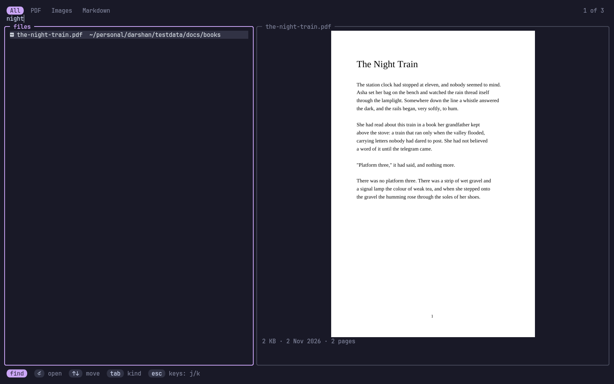
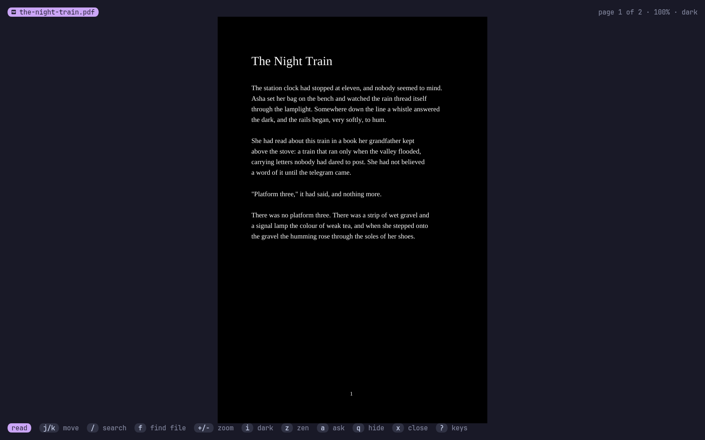
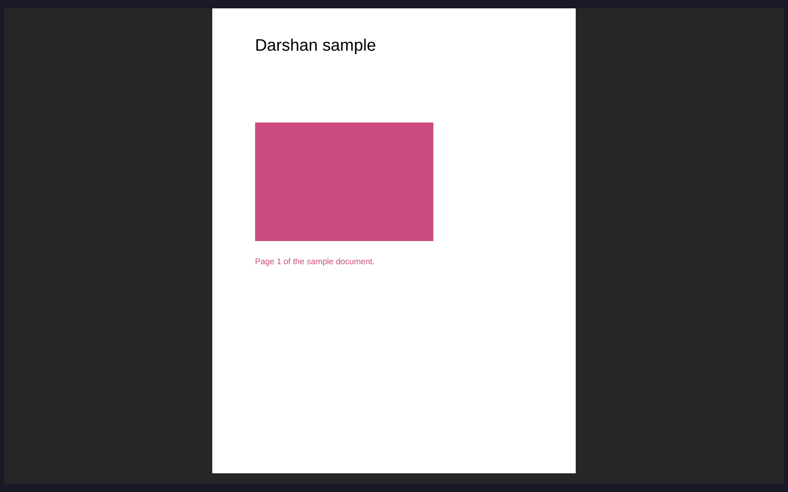

<p align="center">
  
</p>

<p align="center">
  <b>PDFs, images and Markdown in your terminal.</b><br>
  Vim keys, a search across the whole system with a live preview, and a line to the AI agent that opened the file.
</p>

<p align="center">
  
</p>
<p align="center">
  
  
</p>
<p align="center"><sub>Screenshots use made-up files.</sub></p>

> *Darshan* (दर्शन) is Sanskrit for "seeing": a view of something, taken in
> properly.

**darshan** opens in a tmux popup, inside your work. Close it and your file
stays open, on the same page, until you say otherwise. Press one key and it
fills the screen with nothing but the page. Ask an agent to show you a document
and you can question it from right there: your question reaches the agent with
the page you're on, and its answer shows beside the page.

## Contents

- [Features](#features)
- [Install](#install)
- [Keys](#keys)
- [AI agents](#ai-agents)
- [Options](#options)
- [How it draws](#how-it-draws)

## Features

- **Real pages and pictures** on kitty and Ghostty, inside tmux and its popups
  too; coloured blocks on other terminals. Markdown is drawn as styled text.
- **Vim keys**: `j k h l`, `gg G`, counts (`5j`, `12G`), `Ctrl+d`/`Ctrl+u`, `/`
  with `n`/`N`, `:` for commands (a page number, `q`, `bd`, `e FILE`).
- **Search the whole system**: `f` finds any PDF, image or Markdown file by
  name, with a live preview of the one you're on. Recent files come first.
- **The popup remembers**: `prefix v` opens it and closes it. Your file and page
  come back until you close the file with `x`.
- **Zen mode**: `z` switches between the normal popup and the full screen with
  nothing but the page.
- **Dark mode**: `i` inverts pages and pictures, for reading at night.
- **It follows the file**: when a file changes, it reloads and keeps your page.
- **AI agents**: an MCP server lets any agent show you a file and talk about it.

## Install

```sh
curl -fsSL https://raw.githubusercontent.com/Theyashsawarkar/darshan/main/install.sh | bash
```

Or `make install`, or with TPM: `set -g @plugin 'Theyashsawarkar/darshan'`,
which binds `prefix v`. It needs **poppler** (`pdftoppm`, `pdfinfo`,
`pdftotext`) for PDFs and **fd** for the search; `darshan doctor` checks. tmux
needs `set -g allow-passthrough on` only for other tools: darshan writes
straight to the client's terminal.

To make it the desktop's viewer, install `packaging/darshan.desktop` and
`xdg-mime default darshan.desktop application/pdf image/png image/jpeg`.
`darshan open FILE` shows a file in the running screen, a tmux popup, or from
the desktop a kitty window of its own.

| Command | Does |
|---|---|
| `darshan [FILE] [-p N]` | The screen, on FILE or what you left open |
| `darshan open FILE [-p N]` | Show FILE from anywhere |
| `darshan popup` | Open the tmux popup, or close it when it's open |
| `darshan search WORDS [--kind pdf]` | Find files by name: one path a line |
| `darshan status` | What's open |
| `darshan close` | Close the open file |
| `darshan mcp` | The MCP server |
| `darshan doctor` | Check what it needs |

## Keys

**Reading**

| Key | |
|---|---|
| `j / k` | Move down / up (next / previous page once the page is all shown) |
| `h / l` | Move left / right when zoomed (else previous / next page) |
| `J / K` | Move to the next / previous page |
| `Ctrl+d / Ctrl+u` | Scroll half a screen down / up |
| `Ctrl+f / Ctrl+b` | Scroll a screen down / up |
| `g g / G` | Jump to the first / last page |
| `N G / : N` | Jump to page (or line) N; a number before j, k, J or K repeats it |
| `/` | Search the document's text |
| `n / N` | Jump to the next / previous match |
| `+ / -` | Grow / shrink the zoom |
| `=` | Reset to fit the whole page |
| `w` | Toggle fitting the page's width |
| `i` | Invert the colours of pages and pictures (dark mode) |
| `[ / ]` | Switch to the previous / next file in the folder |
| `f / o / Ctrl+p` | Search for a file on the whole system (with a preview) |
| `a` | Open the talk with the agent that opened this file, to ask it something |
| `z` | Toggle zen mode: the full screen, nothing but the page |
| `r` | Reload the file (it also reloads by itself when it changes) |
| `y` | Copy the file's path |
| `q / v` | Close the popup; the file stays open for next time |
| `x` | Close the file |
| `?` | Show every key |

**Searching for a file**

| Key | |
|---|---|
| `Enter` | Open the picked file |
| `Up / Down / Ctrl+j / Ctrl+k` | Move through the results while typing |
| `Esc` | Leave typing, then j, k, g g, G and Ctrl+d / Ctrl+u move (i types again; Esc again closes) |
| `Tab / Shift+Tab` | Switch between all files, PDFs, images and Markdown |

**Talking to the agent**

| Key | |
|---|---|
| `Enter` | Send your question, with what's on screen, to the agent |
| `Esc` | Close the talk |

## AI agents

Add it once and every agent can use it:

```sh
claude mcp add darshan -- darshan mcp
```

| Tool | Does |
|---|---|
| `view_open` | Show the user a file (`path`, `page`, `why`) |
| `view_search` | Find files anywhere on the system by name |
| `view_status` | What's open, the page, the text on their screen |
| `view_next_question` | Wait for the user's next question |
| `view_reply` | Show an answer beside the page |
| `view_close` | Close the file |

**Asking.** When an agent opened the file, `a` opens the talk beside the page.
Your question goes with the file, the page and the text on your screen: to the
agent if it's waiting in `view_next_question`, else typed straight into its tmux
pane, so it arrives like a message from you. If that pane has dropped to a shell
darshan won't type there; the question waits until the agent next asks for it.
The document's text is marked as data, so words inside a PDF can't pose as your
instructions. If the agent regenerates the file, it reloads where you were.

## Options

`~/.config/darshan/config.toml`:

```toml
roots   = ["~/more-books"]   # folders to search, beside home, other disks and system docs
exclude = ["archive"]        # folder names to skip, beside node_modules, .git, .cache and the like
```

tmux options, before TPM's `run` line:

| Option | Default | |
|---|---|---|
| `@darshan-key` | `v` | The popup key after the prefix (`none` binds nothing) |
| `@darshan-width` | `90%` | Popup width |
| `@darshan-height` | `88%` | Popup height |
| `@darshan-title` | ` darshan ` | Popup title |
| `@darshan-launcher` | | Your own popup command, given display-popup's arguments |

Colours follow [varna](https://github.com/Theyashsawarkar/varna) when it's there.

## How it draws

PDF pages become PNGs through poppler's `pdftoppm` (cached in
`~/.cache/darshan`). They reach the terminal by kitty's graphics protocol,
written to the tmux client's own terminal, and show through Unicode placeholders,
which any text layout carries: that's why they work in popups, where viewers that
draw directly (tdf, for one) show nothing.

Not yet: highlighting a match on a PDF page (`/` jumps to the page), animated
GIFs (the first frame shows), pictures inside Markdown.
